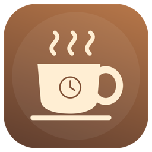
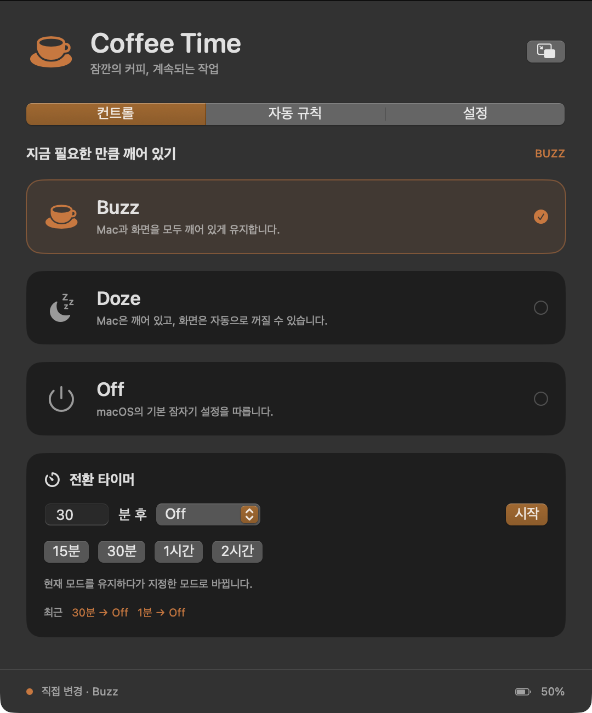
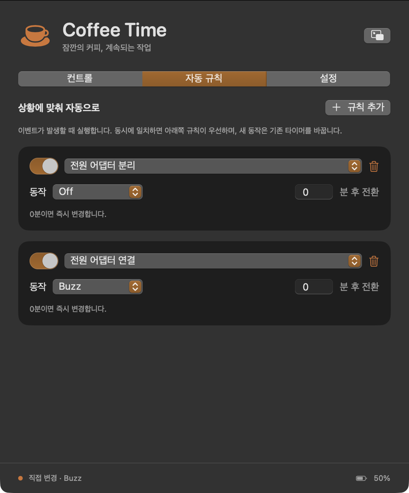

<p align="center">
  
</p>

<h1 align="center">Coffee Time</h1>

<p align="center">
  필요한 동안 Mac을 깨워 두고, 화면은 원하는 대로
</p>

<p align="center">
  <a href="https://github.com/henrychoi7/coffee-time/releases/latest"><strong>Apple Silicon용 다운로드</strong></a>
  &nbsp; · &nbsp;
  <a href="https://github.com/henrychoi7/coffee-time/releases">릴리스 노트</a>
  &nbsp; · &nbsp;
  <a href="https://github.com/henrychoi7/coffee-time/issues">문제 제보</a>
</p>

<p align="center">
  <a href="https://github.com/henrychoi7/coffee-time/releases/latest"></a>
  
  <a href="LICENSE"></a>
</p>

<p align="center"><a href="README.md">English</a> · <strong>한국어</strong></p>

<br>

## Mac이 잠드는 시간을 내 손으로

Coffee Time은 메뉴 막대에서 실행되는 작은 앱입니다. 오래 걸리는 다운로드나 발표처럼 Mac이 계속 깨어 있어야 할 때 사용하세요.

| 모드 | Mac | 화면 |
| :--- | :--- | :--- |
| **Buzz** | 깨어 있는 상태 유지 | 켜진 상태 유지 |
| **Doze** | 깨어 있는 상태 유지 | 자동 꺼짐 허용 |
| **Off** | macOS 설정 따름 | macOS 설정 따름 |

- **타이머**로 작업이 끝날 때 모드 전환
- **자동 규칙**으로 전원, 배터리 잔량, 다른 앱, 시스템 시작에 맞춰 동작
- **알림과 미니 창**에서 모드와 남은 시간 확인
- **자동 업데이트**로 서명된 최신 버전 설치

<br>

## 앱 화면

macOS에서 실행 중인 Coffee Time 1.1.1의 실제 화면입니다. 이미지를 클릭하면 원본 크기로 볼 수 있습니다.

<table>
  <tr>
    <th>컨트롤</th>
    <th>자동 규칙</th>
  </tr>
  <tr>
    <td><a href="docs/assets/screenshots/controls-ko.png"></a></td>
    <td><a href="docs/assets/screenshots/rules-ko.png"></a></td>
  </tr>
</table>

<br>

## 시작하기

**Apple Silicon · macOS 13 이상**

1. [최신 릴리스](https://github.com/henrychoi7/coffee-time/releases/latest)에서 DMG 다운로드
2. DMG를 열고 **Coffee Time**을 **Applications** 폴더로 이동
3. 앱을 실행한 뒤 메뉴 막대의 커피잔 클릭

앱의 기본 언어는 **영어**이며, macOS 언어 설정이 **한국어**이면 한국어로 표시합니다. **시스템 설정 → 일반 → 언어 및 지역 → 응용 프로그램**에서 Coffee Time의 언어만 따로 지정할 수도 있습니다. 언어를 바꾼 뒤에는 앱을 다시 실행하세요.

> [!NOTE]
> 현재 배포본은 Apple의 Developer ID 서명과 공증을 받지 않았습니다. 처음 실행할 때 macOS가 차단할 수 있습니다. 이 저장소에서 받은 파일인지 확인한 뒤 **시스템 설정 → 개인정보 보호 및 보안**에서 실행을 허용하세요.

Intel Mac은 지원하지 않습니다.

<br>

## 일상에 맞게 사용하기

메뉴 막대의 커피잔을 오른쪽 클릭하면 **Off → Buzz → Doze** 순서로 전환됩니다. 설정에서 이 동작을 끌 수 있습니다.

| 단축키 | 동작 |
| :--- | :--- |
| **⌘W** | 창만 닫고 Coffee Time은 계속 실행 |
| **⌘Q** | 앱 종료와 함께 잠자기 방지 해제 |

<details>
<summary><strong>타이머와 미니 창</strong></summary>

타이머는 현재 모드를 유지하다가 지정한 시간이 지나면 선택한 모드로 전환합니다. 1분부터 7일까지 설정할 수 있고, 최근 타이머 세 개를 다시 사용할 수 있습니다.

미니 창은 다른 창 위에 표시되어 현재 모드와 남은 시간을 쉽게 확인할 수 있습니다.

</details>

<details>
<summary><strong>자동 규칙</strong></summary>

전원 어댑터 연결과 분리, 배터리 잔량 감소, 다른 앱 실행과 종료, 시스템 시작에 맞춰 모드를 바꿀 수 있습니다.

- 지연 시간이 **0분**이면 즉시 적용
- 같은 이벤트에 여러 규칙이 해당하면 아래쪽 규칙 우선
- 새 규칙 동작이나 수동 모드 변경 시 기존 타이머 대체 또는 취소

전원 상태는 macOS의 변경 알림으로 확인합니다. 알림을 등록하지 못했을 때만 1초마다 확인합니다. 배터리 규칙은 충전 중에는 실행하지 않으며, 잔량이 기준을 넘었다가 다시 내려오면 재실행할 수 있습니다.

**시스템 시작 규칙**은 재부팅 후 Coffee Time이 처음 실행될 때 한 번 적용됩니다. **로그인 시 자동 실행**을 켜 두면 로그인 후 자동으로 실행됩니다. 같은 부팅에서 앱을 다시 열거나, 로그아웃 후 로그인하거나, 절전에서 깨어나는 경우에는 반복하지 않습니다. 새로 만든 시작 규칙은 다음 재부팅부터 적용되며, 로그인 전에는 앱이 실행되지 않습니다.

</details>

<details>
<summary><strong>알림과 화면 보호</strong></summary>

모드 변경 알림에는 새 모드와 전환 이유가 표시됩니다. macOS 알림 권한이 필요하며, 집중 모드나 화면 공유 설정에 따라 배너가 숨겨질 수 있습니다.

기본 설정에서는 **입력 없이 120분**이 지나면 Buzz에서 Doze로 전환하고 진행 중인 타이머를 취소합니다. 입력 여부 대신 Buzz 시작 후 경과 시간을 기준으로 삼거나, 시간을 15분에서 8시간 사이로 바꿀 수 있습니다.

앱을 종료하면 이 앱이 설정한 잠자기 방지가 해제됩니다. 덮개를 닫거나 Apple 메뉴에서 잠자기를 선택하는 동작은 막지 않습니다. 화면 잠금과 보안 정책도 변경하지 않습니다.

</details>

<br>

## 업데이트는 알아서

실행할 때와 매시간 GitHub의 정식 릴리스를 확인합니다. 새 버전이 있으면 내려받아 서명을 확인하고 설치한 뒤, **모드와 타이머를 유지한 채 다시 실행**합니다.

바로 확인하려면 <strong>업데이트 확인…</strong>을 선택하세요. 수동으로 업데이트하고 싶다면 설정에서 **새 버전을 자동으로 받아 설치**를 끄세요.

<details>
<summary><strong>업데이트 보안과 이전 버전</strong></summary>

[Sparkle](https://sparkle-project.org)이 업데이트 목록과 파일의 Ed25519 서명을 확인합니다. 서명이 맞지 않으면 설치하지 않습니다. 업데이트를 확인할 때 GitHub에 연결하며, 별도의 사용 기록이나 시스템 프로필은 보내지 않습니다.

**1.0.4 이하 버전**에는 자동 업데이트가 없습니다. 최신 DMG로 한 번 설치하면 이후부터 자동 업데이트를 받을 수 있습니다.

</details>

<br>

## 빌드와 기여

Apple Silicon Mac, Xcode 또는 macOS SDK가 포함된 Command Line Tools, Python 3가 필요합니다.

```sh
git clone https://github.com/henrychoi7/coffee-time.git
cd coffee-time
./scripts/build.sh
./scripts/test.sh
open 'dist/Coffee Time.app'
```

첫 빌드에서는 Sparkle 2.10.1을 공식 릴리스에서 내려받고 SHA-256을 확인합니다. 설정과 규칙은 로컬 UserDefaults에 저장됩니다. 일반 실행에서는 시작 규칙이 없다면 Off로 시작하고, 업데이트 후 다시 실행할 때는 이전 모드와 타이머를 복원합니다.

문제 제보와 Pull Request를 환영합니다. 문제를 제보할 때는 macOS 버전, Coffee Time 버전, 재현 방법을 함께 알려 주세요. 커밋에는 `git commit -s`로 Signed-off-by를 넣어 주세요.

| 문서 | 내용 |
| :--- | :--- |
| [변경 기록](CHANGELOG.md) | 버전별 변경 사항 |
| [테스트 안내](docs/TESTING.md) | 자동 검사와 수동 검증 방법 |
| [릴리스 안내](docs/RELEASING.md) | 패키징, 서명, 업데이트 배포 |

<br>

## 프로젝트 소개와 라이선스

Coffee Buzz를 더 이상 내려받을 수 없어 Apple Silicon용으로 새로 만들었습니다. 공개된 기능 설명을 참고했으며 원본 코드, 아이콘, 리소스를 가져오지 않았습니다. 원본 실행 파일을 확보하지 못해 세부 동작에는 차이가 있을 수 있습니다.

Coffee Time은 [MIT 라이선스](LICENSE)로 배포합니다. 저작권 및 라이선스 고지를 유지하면 상업적 이용을 포함해 사용, 수정, 재배포할 수 있습니다.

Sparkle과 포함된 외부 코드는 각자의 라이선스를 따릅니다. [서드파티 고지](THIRD_PARTY_NOTICES.txt)에서 확인할 수 있습니다.
