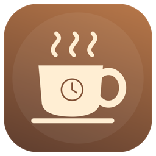

<p align="center">
  
</p>

<h1 align="center">Coffee Time</h1>

<p align="center">
  Keep your Mac awake. Let the display rest when you want.
</p>

<p align="center">
  <a href="https://github.com/henrychoi7/coffee-time/releases/latest"><strong>Download for Apple Silicon</strong></a>
  &nbsp; · &nbsp;
  <a href="https://github.com/henrychoi7/coffee-time/releases">Release notes</a>
  &nbsp; · &nbsp;
  <a href="https://github.com/henrychoi7/coffee-time/issues">Report an issue</a>
</p>

<p align="center">
  <a href="https://github.com/henrychoi7/coffee-time/releases/latest"></a>
  
  <a href="LICENSE"></a>
</p>

<p align="center"><strong>English</strong> · <a href="README.ko.md">한국어</a></p>

<br>

## A little control over when your Mac sleeps

Coffee Time lives in your menu bar. Use it for a long download, a presentation, or any task that needs your Mac to stay awake.

| Mode | Your Mac | Your display |
| :--- | :--- | :--- |
| **Buzz** | Stays awake | Stays on |
| **Doze** | Stays awake | Can sleep |
| **Off** | Follows macOS settings | Follows macOS settings |

- **Set a timer** to switch modes when your work is done
- **Create rules** for power, battery level, other apps, and system startup
- **Stay informed** with mode change notifications and a floating mini window
- **Keep up to date** with signed automatic updates from GitHub

<br>

## Get started

**Apple Silicon · macOS 13 or later**

1. Download the DMG from the [latest release](https://github.com/henrychoi7/coffee-time/releases/latest)
2. Open it and drag **Coffee Time** into **Applications**
3. Launch the app and click the coffee cup in your menu bar

The app uses **English by default** and **Korean when selected in your macOS language preferences**. You can also choose a language for Coffee Time in **System Settings → General → Language & Region → Applications**. Relaunch the app after changing its language.

> [!NOTE]
> The current release is not signed with an Apple Developer ID or notarized. macOS may block the first launch. After confirming that you downloaded it from this repository, allow it to open in **System Settings → Privacy & Security**.

Intel Macs are not supported.

<br>

## Make it part of your day

Right-click the menu bar icon to cycle through **Off → Buzz → Doze**. You can turn this shortcut off in Settings.

| Shortcut | Action |
| :--- | :--- |
| **⌘W** | Close the window and keep Coffee Time running |
| **⌘Q** | Quit and release sleep prevention |

<details>
<summary><strong>Timers and the mini window</strong></summary>

A timer keeps the current mode active, then switches to your chosen mode when time runs out. Choose anything from one minute to seven days, or reuse one of your three most recent timers.

The mini window stays above other windows so your current mode and countdown are always within reach.

</details>

<details>
<summary><strong>Automatic rules</strong></summary>

Switch modes when the power adapter connects or disconnects, the battery falls to a chosen level, another app launches or quits, or the system starts.

- A delay of **0 minutes** applies the rule immediately
- The last matching rule takes priority when several rules match
- A new rule action or manual mode change replaces or cancels the active timer

Power changes use macOS notifications. The app checks once a second only if it cannot register for those notifications. Battery rules do not run while charging and can run again after the battery rises above the threshold and drops back down.

**Startup rules** run once, when Coffee Time first opens after a reboot. Enable **Launch at Login** to run them automatically after login. Relaunching the app, logging out and back in, or waking from sleep does not trigger them again during the same boot. A new startup rule takes effect after the next reboot; Coffee Time does not run before login.

</details>

<details>
<summary><strong>Notifications and display protection</strong></summary>

Mode change notifications show the new mode and what triggered it. macOS notification permission is required, and Focus modes or screen sharing settings may hide banners.

By default, Coffee Time switches from Buzz to Doze after **120 minutes without input**, canceling any active timer. You can use time spent in Buzz instead, or choose a duration from 15 minutes to eight hours.

Quitting releases all sleep prevention set by the app. Closing the lid or choosing Sleep from the Apple menu still puts your Mac to sleep. Screen lock settings and security policies stay unchanged.

</details>

<br>

## Updates that take care of themselves

Coffee Time checks for stable GitHub releases at launch and every hour. It downloads updates, verifies their signatures, installs them, and relaunches with your **mode and timer intact**.

Use **Check for Updates…** for an immediate check. Turn off **Download and install updates automatically** in Settings if you prefer manual updates.

<details>
<summary><strong>Update security and older versions</strong></summary>

[Sparkle](https://sparkle-project.org) verifies Ed25519 signatures on both the update feed and the archive before installation. Invalid signatures are rejected. Update checks connect to GitHub; Coffee Time does not send usage records or a system profile.

Versions **1.0.4 and earlier** do not have an updater. Install a current DMG once to receive future updates automatically.

</details>

<br>

## Build and contribute

You need an Apple Silicon Mac, Xcode or Command Line Tools with the macOS SDK, and Python 3.

```sh
git clone https://github.com/henrychoi7/coffee-time.git
cd coffee-time
./scripts/build.sh
./scripts/test.sh
open 'dist/Coffee Time.app'
```

The first build downloads Sparkle 2.10.1 from its official release and verifies its SHA-256 checksum. Settings and rules are stored locally in UserDefaults. A normal launch starts in Off unless a startup rule applies; an update relaunch restores the previous mode and timer.

Bug reports and pull requests are welcome. For a bug report, include your macOS version, Coffee Time version, and steps to reproduce it. Please use a Signed-off-by trailer for commits, as produced by `git commit -s`.

| Guide | What you’ll find |
| :--- | :--- |
| [Changelog](CHANGELOG.md) | Changes by version |
| [Testing](docs/TESTING.md) | Automated checks and manual verification |
| [Releasing](docs/RELEASING.md) | Packaging, signing, and publishing updates |

These guides are currently in Korean.

<br>

## About and license

Coffee Time was built from scratch for Apple Silicon after Coffee Buzz became unavailable to download. It uses publicly available feature descriptions and does not copy the original app’s code, icons, or resources. The original executable was not available for comparison, so some behavior may differ.

Coffee Time is available under the **[MIT License](LICENSE)**. You may use, modify, and redistribute it, including commercially, as long as you retain the copyright and license notices.

Sparkle and its bundled dependencies retain their own licenses. See [third-party notices](THIRD_PARTY_NOTICES.txt).
